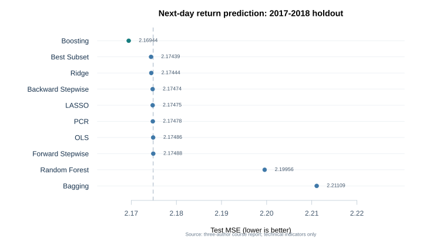

# Predicting next-day U.S. stock returns with machine learning

An applied machine learning course project comparing ten methods on daily price and volume data for 505 S&P 500 stocks. **Caijunyi Sun led the code and analysis**; the original May 2026 report was coauthored with **Cindy Wang** and **Jinxu Han**.

## Question and approach

Can machine learning improve one-day-ahead return prediction over an ordinary least squares (OLS) baseline? We constructed ten price and volume indicators from 619,040 stock-day records, then evaluated the models on a chronological holdout covering 2017–2018. Model selection used only the training period through 2016.

The methods are OLS, best subset selection, forward and backward stepwise selection, ridge, LASSO, principal components regression, bagging, random forest, and gradient boosting. The complete feature definitions, code, model settings, and discussion are in [`econ491_paper.Rmd`](econ491_paper.Rmd).

## Results

The original report's strongest result was modest: boosting achieved a test MSE of **2.16944**, compared with **2.17486** for OLS, about a **0.25%** reduction. All ten models were close to the unconditional variance of next-day returns, so this exercise does not establish a profitable trading strategy.

The comparison uses a single historical holdout and only technical indicators. The report discusses the implications of those limits and the differences between linear and tree-based methods.

## Reproduce the analysis

1. Install R and the packages `data.table`, `ggplot2`, `glmnet`, `ranger`, `knitr`, `kableExtra`, `corrplot`, `leaps`, `pls`, `gbm`, and `rmarkdown`.
2. Download `all_stocks_5yr.csv` from the [Kaggle dataset cited by the report](https://www.kaggle.com/datasets/rohitjain454/all-stocks-5yr) and place it beside `econ491_paper.Rmd`. The [original S&P 500 dataset card](https://www.kaggle.com/datasets/camnugent/sandp500) also lists this CSV and its CC0 license. The CSV is excluded from this repository.
3. From the repository directory, run `Rscript -e 'rmarkdown::render("econ491_paper.Rmd")'`.

The input used for this release has 619,040 rows and seven columns (`date`, `open`, `high`, `low`, `close`, `volume`, `Name`). The R Markdown file runs without cached model results, so it recomputes all models and charts from the CSV.

## Changes made for this portfolio release

- Removed stale R Markdown caching after finding a chart that did not match the ten-model results table.
- Qualified the `corrplot` call to avoid a same-named function from another package.
- Corrected the input column count in the report.
- Calculated in-sample training MSE for bagging and random forest in the comparison table; the original table had used out-of-bag error for these two rows.

The original source and full report are credited to all three authors. This repository does not include the raw dataset, course instructions, or temporary R output.
